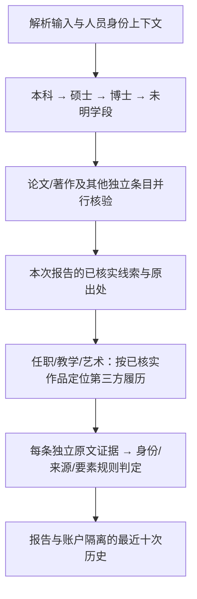

# 指导老师建议的落地：专项 agent、数据源和协作

在上一版实习人工背调与分类取证的基础上，把“专项目的”接入实际执行，而不只给分类起名称。`verification_agents.py` 负责专项职责与调度，`data_sources.py` 负责可调用的数据源合同、隔离作用域与实际调用记录。继续共用既有模型与检索连接，沿用账户 API 绑定、并发限制、单域抓取限速和每条预算，不复制服务进程。

## 专项分工

| agent | 对应陈述 | 数据源/工具 | 必须分别核对 |
| --- | --- | --- | --- |
| education | 学历 | 学校目录、公开招生/培养/毕业材料及附件、第三方本人履历 | 学校、学段、推荐资格、录取、就读、学位授予、年份 |
| employment | 任职 | 独立第三方履历、协会/项目/会议任职记录 | 单位、职位、任期；参与活动和合作不是任职 |
| paper | 论文 | Crossref/OpenAlex 公开登记 API、期刊/出版社原文 | 标题/DOI、作者身份、刊物、年份、发表状态和作者角色 |
| book | 著作/教材 | 公开馆藏责任者和出版社书目 | 题名/ISBN、责任者、角色、出版方、版本；数量另核 |
| patent | 专利/软著 | 既有专利检索路径和公开公告 | 编号、发明人、申请人、类型、申请/公开/授权状态 |
| conference | 会议 | 主办方议程、报告和公开参会材料 | 会议、年份、报告/墙报/主持/参会；参会不是发表 |
| competition | 竞赛 | 赛事目录与历年入口、主办方名单、学校参赛材料 | 年份/届次、赛道、国/省赛、奖级、成员关联 |
| award | 荣誉/奖学金 | 对应学校正式荣誉公示 | 学校、本人、奖名、年份、学段、正式获奖阶段 |
| internship | 实习 | 企查查公司查询入口及公开电话 | 仅人工背调入口，不能自动证实本人实习 |
| project | 项目/开源项目 | 独立项目材料、本条明示的 GitHub 仓库/PR/commit | 参与、主导、范围、指标和账号归属 |
| teaching | 教学 | 独立课程和活动主办方材料 | 课程、授课/组织/指导角色、时间、修饰语 |
| art | 艺术成果 | 独立节目单与作品/演出记录 | 本人、作品、创作/演出角色、年份、首演等修饰语 |
| student_work | 学生工作 | 组织职务公示与独立活动记录 | 学校/组织、职务、任期 |

注册表列出真实可执行的适配器与类别限制。论文登记仅用于论文；实习仅查公司联系方式；未主动提供本项目 GitHub 材料时不启动该工具。原检索计划中不属于本类别的接口会被剔除并记录原因，不能绕到无关数据库撒网。公开抓取仍受原来源过滤、robots.txt、超时和访问限制约束。

这里的“数据库”分为公开登记数据源、用于定位的本地学校/赛事目录、以及保存报告的现有 SQLite。目录不提供某个人的学籍或获奖证明；并未获得访问学信网或企业内部人事库的权限，也不会声称能直接查询。需要授权的材料维持人工补证流程。

## 协作执行

调度仅包含用户勾选的条目。没有选论文/著作时，任职、教学与艺术照常直接查询；前序未找到证据时，后续仍独立核对。学历阶段保持原顺序，同批独立任务继续并行。待核条目最多增加一个“候选人 + 已核实作品 + 本条目的”查询，仍使用原预算，不另开搜索额度。

共享只接受已核实或部分核实条目中的已证明字段，并要求有本人身份分、直接原文及出处。未证明的学位/时间、身份冲突、未回读摘要、OCR及实习联系方式不能传播为事实。作品线索不能复制成任职或授课证明，学历线索不能复制成获奖证明。学校、学段、年份、人员冲突、现任机构排除及本校例外、输入主页不得自证等规则继续生效。

每条 task 独立绑定 source context，嵌套并发继承正确的作用域，结束或异常时复原。过程记录区分目录、搜索、读页、结构化接口及项目审计，写出 returned/empty/failed、适配器记录数和预算实际使用；不保存页面正文、请求头、密钥或供应商原始报错。URL 中的认证参数会脱敏，最多记录 80 次调用并标明截断。它只说明查询过程，不提升任何证据等级。

## 报告与持久化

`Report.verification_workflow` / HTTP `verificationWorkflow` 保存任务分工、执行批次、实际数据源调用与带出处的跨 agent 线索。每条 `verificationAgent` 包含职责、可用工具、调用记录和协作线索。`/api/plan` 返回实际专项分工与定位线索；Markdown 导出增加“核验分工与协作”，并明确线索不是证明。

协作 workspace 每次核验新建，不复用其他人或其他账户的事实缓存。过程元数据附随报告保存于现有 `report_history.report_json`，无需新数据库迁移；账户隔离、最近十次淘汰、退出查询与登出规则保持原契约。旧报告没有新字段仍可加载和导出。

## 验证

新增 18 项核心行为检查与 3 项服务契约检查：类别/工具分工、未授权数据源阻断、真实论文接口派发、不泄露报错密钥、并发及嵌套作用域隔离、缺失前序材料继续核验、实际改变后续检索但不借证、目录不证实就读、只调度勾选项、报告持久化/跨账户拒绝/十次淘汰与旧报告兼容。

本地回归：502 项核心、33 项服务、两项前端脚本检查通过；旧验收仍 28/33，5 项既有差异未隐藏，见 REGRESSION.md。线上前端继续保留服务器原版本，本次只更新后端与报告接口；其既有 Usage.start 接口与本地旧检查不一致，发布前后需单独比对。线上部署与实际接口冒烟以 `outputs/advisor-verification/` 的结果为准；离线检查不代表真实 API 可用率或召回率已被测量。

已部署至 https://underbox.online/，服务器备份 `/opt/underbox/backups/advisor-20261013-005042`（服务器时区）。登录后健康、公网前端原文件版本、已安装代码的专项协作与论文登记派发、实习回退，以及报告/计划/导出 HTTP 合成冒烟均通过。未变更账户、API、配额及前端文件；验证未消耗核验次数，也未调用付费搜索。线上旧前端检查失败与部署前逐字一致，已单独记录，不能写成所有检查通过。
